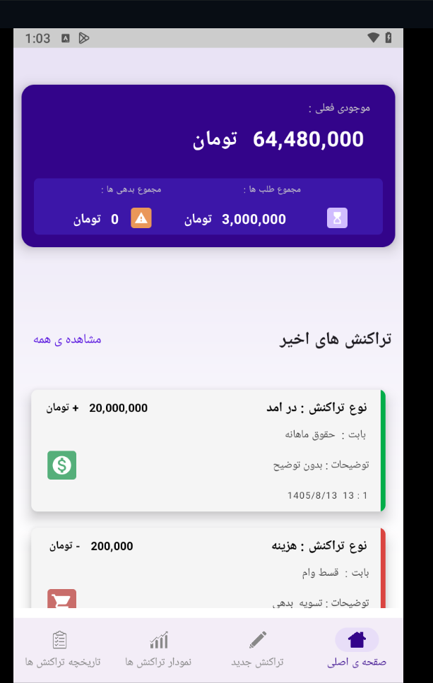
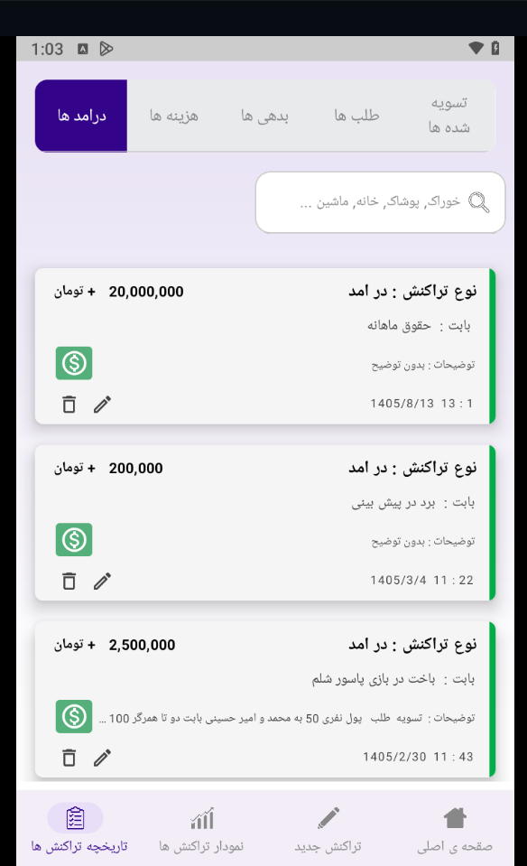
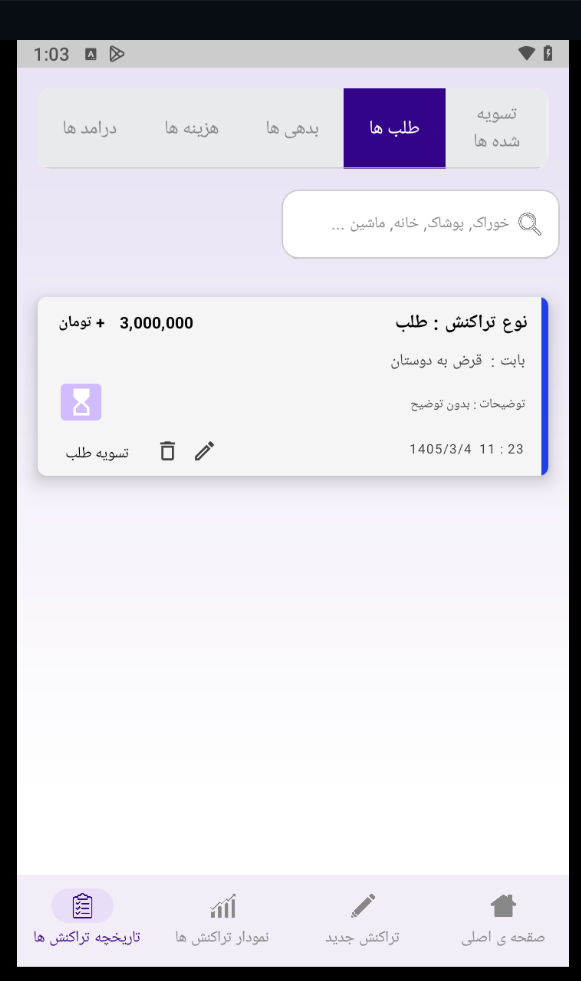
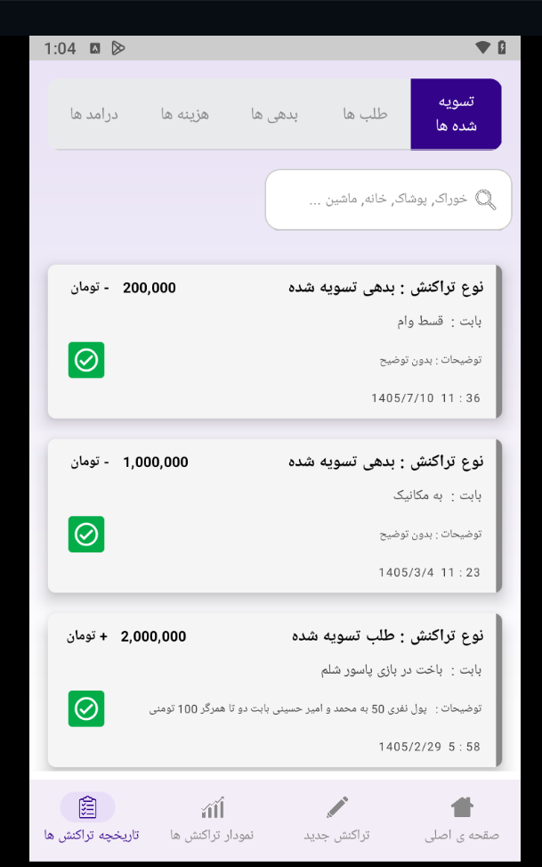
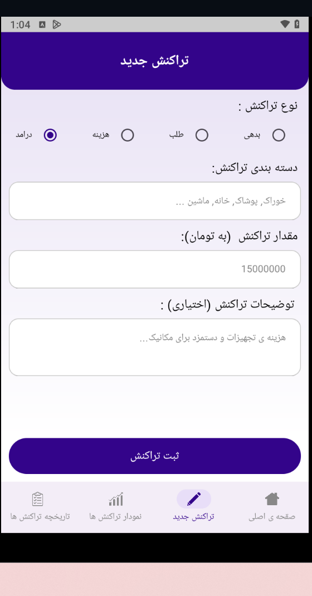
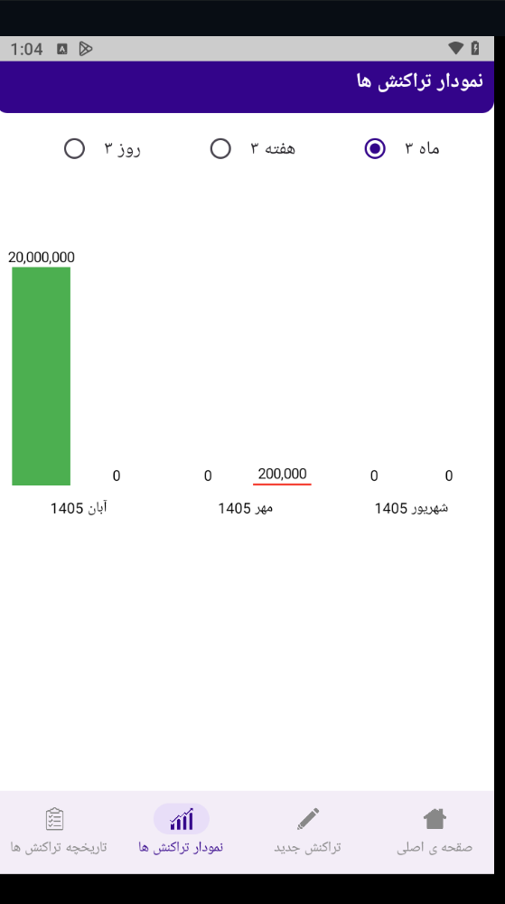

Accounting App

An Android Accounting application built with Kotlin and Jetpack Compose.

Screenshots

Main — Browse Movies by Genre

  
  
 

TransactionHistory

  
  
  

AddTransaction & chart

  
  

Tech Stack

- Kotlin
- Jetpack Compose
- Android SDK